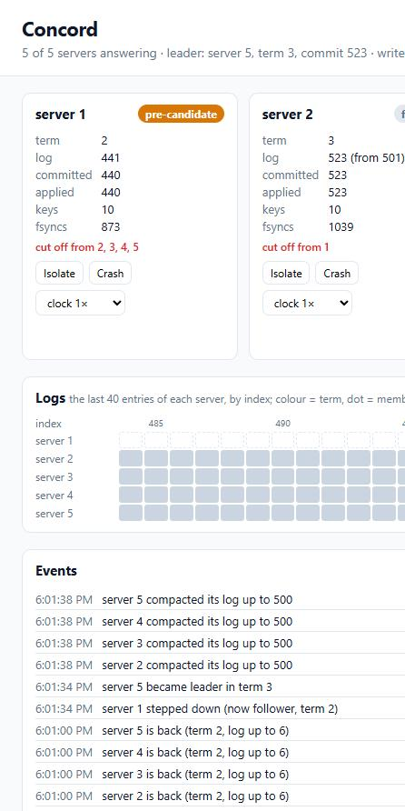

# Concord

A replicated key-value store built on Raft written from scratch, tested the way Jepsen tests databases. The project has four parts:

- **Server (Go).** Raft with:
  - pre-vote and check-quorum;
  - ReadIndex reads;
  - snapshots;
  - membership changes;
  - a write-ahead log on disk;
  - a TCP transport into which faults can be injected.
- **Checker (Rust).** Decides whether a recorded history of operations is linearizable.
- **Chaos harness (Python).** Runs real server processes, breaks them in 11 ways, records what clients saw, and asks the checker.
- **Dashboard (TypeScript).** Shows the cluster live: roles, terms, logs aligned by index, events, and buttons to isolate, crash or skew a server.



## Results

### Linearizability under faults

[`concord_chaos.run`](chaos/concord_chaos/run.py) ran **330 scenarios**: 30 for each of 11 fault schedules. Each scenario goes like this:

1. A fresh 5-server cluster starts. Snapshots are taken every 300 entries, so snapshot installs happen during faults.
2. 8 clients run for 8 s against 6 keys, mixing gets, puts, deletes and compare-and-set.
3. Meanwhile, a fault schedule acts on the cluster, alternating 1–2 s of fault with a short heal.
4. The cluster is healed and clients run 1.5 s more.
5. [`concord-check`](checker/src/lib.rs) checks the whole history.

| schedule | what it does | faults injected | operations | outcome unknown | linearizable |
|---|---|---|---|---|---|
| none | — | — | 114,076 | 0 | 30 / 30 |
| partition | random minority / majority split | 155 | 111,739 | 186 | 30 / 30 |
| isolate-leader | the leader alone on one side | 154 | 100,523 | 594 | 30 / 30 |
| bridge | two halves that each reach one middle server | 162 | 116,854 | 2 | 30 / 30 |
| kill | SIGKILL / TerminateProcess of 1–2 servers, restart from disk | 203 kills | 101,139 | 273 | 30 / 30 |
| kill-leader | kill the current leader, restart it | 138 kills | 66,127 | 980 | 30 / 30 |
| packet-loss | 10–40% of messages dropped on every server | 166 | 118,765 | 0 | 30 / 30 |
| delay | 0–80 ms delay plus 0–80 ms jitter | 137 | 42,442 | 19 | 30 / 30 |
| clock-skew | servers' timers run at 0.25×–4× real time | 154 | 113,869 | 3 | 30 / 30 |
| membership | remove a server, wipe its disk, add it back empty | 92 removed, 92 added | 91,148 | 713 | 30 / 30 |
| mixed | a random fault every 1.5–3 s | (included above) | 104,835 | 293 | 30 / 30 |
| **all** | | **1,453** | **1,081,517** | **3,063** | **330 / 330** |

**Unknown outcomes.** An operation that timed out may or may not have taken effect, so the checker tries both. As in Jepsen, the client that sent it continues as a new process.

**Checking is fast.** Each history takes at most 8 ms, because keys are checked independently and memoisation prunes the search.

**Does the checker catch real bugs?** The same harness was run with `--unsafe-reads`, a deliberate bug: servers answer reads from their own state instead of confirming leadership with ReadIndex, and clients read from any server. Out of 22 runs ([`chaos-unsafe-reads.json`](results/chaos-unsafe-reads.json)):
- **20 were reported not linearizable**, typically a read returning "not found" after a write had completed;
- in 2, the checker hit its search budget and reported no verdict rather than a wrong one.

**Caveats:**
- **Partitions are simulated in software.** Windows has no iptables, so they are made in each server's transport: each blocks messages to and from the other side, on every link, both ways.
- **Kills are real process kills.** A killed process does not lose data the OS already holds, so this cannot catch a missing `fsync`.
- **The campaign was run twice.** The first run (330 of 330 linearizable, too) used a build with the snapshot bug described below. It did not catch the bug, so the numbers above come from a second run on the fixed build.

### Raft on a simulated network

[`raft_test.go`](node/raft/raft_test.go) drives the Raft state machine with no clocks, sockets or goroutines. Every choice comes from one seeded random source, so a failing seed fails the same way every time. That makes failure schedules cheap and repeatable:

- **200 chaos runs in CI, and 3,000 once** (`CONCORD_SIM_RUNS=3000`, all passing), on 3- and 5-server clusters, with and without pre-vote and check-quorum:
  - 10% of messages lost, plus reordering, duplication and delay;
  - random partitions, crashes and restarts from what was persisted;
  - targeted crashes of the leader right after a proposal;
  - log compaction.

  Every step checks that each term has at most one leader, that entries are applied in order without gaps, and that every index has the same term and data on every server. After healing, the cluster must make progress and agree on one commit index.
- **The tests catch real bugs:**
  - letting a vote ignore whether the candidate's log is up to date made **187 of 200** runs fail;
  - counting replicas of an old-term entry for commitment (the bug in Figure 8 of the Raft paper) did *not* show up in the random runs, because the no-op each new leader appends masks it. So `TestFigure8` replays the figure's exact schedule, and that test fails with the bug ("node 5 committed index 6 with term 3; another node with term 2") and passes without it.
- **Other tests:**
  - a minority cannot elect a leader, and when it returns, pre-vote stops it from disrupting the majority (its term stays put);
  - an isolated leader never serves a read, and the pending read fails once check-quorum makes it step down;
  - a lagging follower is brought up to date by InstallSnapshot;
  - a leader removes itself and steps down.

### Recovery after losing the leader

[`recovery.py`](chaos/concord_chaos/recovery.py) ran 50 trials on a 5-server cluster:
- the timer ticks every 10 ms;
- the election timeout is 150–300 ms, randomised;
- one client writes continuously, and the leader is killed with SIGKILL.

| | median | 90th percentile | max |
|---|---|---|---|
| new leader visible | **198 ms** | 243 ms | 280 ms |
| client's next write succeeds | **297 ms** | 319 ms | 363 ms |

The time to the next write includes the client's 250 ms timeout on the dead server. On Windows, a connection to a dead port is not refused at once.

### Throughput and latency against etcd 3.7.3

[`concord-bench`](bench/main.go) drives both systems with the same closed-loop workload ([`results/bench.json`](results/bench.json)):
- 3-server clusters on one machine (Windows 11, NVMe SSD), with default settings and an fsync at every commit;
- 100-byte values over 10,000 keys;
- 10 s measured after 2 s of warm-up;
- reads are linearizable on both: ReadIndex here, etcd's default.

| workload | clients | Concord ops/s | etcd ops/s | Concord p99 ms | etcd p99 ms |
|---|---|---|---|---|---|
| write | 1 | 128 | 247 | 10.3 | 9.6 |
| write | 8 | 444 | 526 | 21.6 | 25.2 |
| write | 32 | 1,754 | 2,046 | 25.5 | 27.0 |
| write | 128 | 5,189 | 7,058 | 71.9 | 35.2 |
| read | 1 | 1,942 | 1,073 | 1.2 | 1.7 |
| read | 8 | 8,873 | 6,366 | 3.1 | 3.1 |
| read | 32 | 14,966 | 11,300 | 6.7 | 8.6 |
| read | 128 | 19,358 | 32,567 | 16.5 | 10.9 |
| mixed (half each) | 1 | 212 | 398 | 9.5 | 8.3 |
| mixed | 8 | 545 | 734 | 25.7 | 27.2 |
| mixed | 32 | 1,845 | 1,594 | 23.6 | 42.7 |
| mixed | 128 | 6,360 | 5,782 | 50.8 | 44.9 |

**Writes: etcd is faster, about 2× for a single client and 1.2–1.4× under load.** The likely cause is the order of the work:
- a Concord leader syncs its own log *before* sending entries to its followers, so a write waits for two fsyncs in a row;
- etcd lets the leader's write overlap replication (section 10.2.1 of Ongaro's dissertation).

Doing the same here means a leader may count itself toward a majority only once its own entry is on disk. That change is not made.

**Reads: Concord wins at low concurrency, etcd at 128 clients.**
- Up to 32 clients, Concord's ReadIndex over plain HTTP is quicker than etcd's gRPC path.
- At 128 clients, etcd batches reads. Concord sends a heartbeat round for every read and pays for JSON encoding on every request.

**One run had to be redone.** In the first full benchmark run, one Concord run showed thousands of errors. A leader change had happened in the middle of it, and the benchmark client did not follow the new leader, as etcd's client does. The run could not be reproduced. The client now follows redirects and counts leader changes: there were none in the run reported above.

## How it works

```
 clients ──HTTP──► server ──► Node (one goroutine) ──► Raft state machine (pure)
                                │  Ready: persist ─► send ─► apply
                                ├─ Storage: log file (entries + hard state, CRC each, 1 fsync per batch), snapshot file
                                ├─ Transport: TCP + gob, per-peer queues, injected drops/delays/partitions
                                └─ KV: map + per-client session table (exactly-once retries)
```

**Raft** ([`raft.go`](node/raft/raft.go)) never does I/O. `Step`, `Tick`, `Propose`, `ReadIndex` and `Compact` change state, and `Ready()` returns what the server must do:
1. persist the hard state, the entries and any snapshot, with one fsync;
2. send the messages;
3. apply the committed entries and serve the reads whose index is applied.

The design choices:
- **Elections:** pre-vote (a candidate first asks whether it *could* win) and check-quorum (a leader that has not heard from a majority within an election timeout steps down). Together, a server that was cut off cannot raise terms and depose a healthy leader when it returns.
- **Commitment:** a leader commits only current-term entries, counting older ones indirectly. A new leader appends a no-op, so reads can be served once that commits.
- **Reads:** ReadIndex. The leader notes its commit index, confirms it is still leader with a round of heartbeats acknowledged by a majority, and serves the read once that index is applied. Reads never go through the log.
- **Membership:**
  - one server changes at a time, and a change takes effect when it is *appended* (it is undone if truncated);
  - founding servers start with identical membership entries at indexes 1..n, so a server that joins later learns the membership by replication;
  - a leader that removes itself steps down once the change commits.
- **Snapshots:** a lagging follower whose next entry has been compacted gets InstallSnapshot.

**Storage** ([`storage.go`](node/server/storage.go)):
- Entries and hard-state records share one file, each with a CRC-32. On start, the file is cut at the first bad record (a torn write).
- When entries are replaced after a conflict, the file is truncated at the first replaced entry and the hard state is written again, so a vote recorded after that entry is not lost (there is a test for this).
- Snapshots are written beside the log, synced, and renamed into place. The log is then rewritten without the entries the snapshot covers.

**Exactly-once.** Each client numbers its requests. The state machine remembers each client's last request and result, and returns the stored result for a retry.

**The checker** ([`lib.rs`](checker/src/lib.rs)):
- It runs the Wing–Gong search with Lowe's memoisation of (linearized set, state), per key (linearizability is compositional), with keys checked in parallel threads.
- The model is a register with put, get, delete and compare-and-set; a failed cas must report the value it found.
- Operations with an unknown outcome get two alternatives: applied, or never happened.
- It is tested on hand-made histories and on 300 random histories taken from sequential executions (all linearizable), each also corrupted (all caught).
- **It was buggy at first.** An operation whose call and return had the same timestamp had its return sorted before its call. At equal times, calls now come first.

### Bugs the tests found

- **Raft (a safety bug).**
  - **What it was.** A follower that received a snapshot it already had (its log matched the snapshot's last entry) answered with the index of the *last entry in its log*. The entries after the snapshot point could belong to another term. The leader took them as matching and could count that follower toward a majority for an entry the follower did not have. Two servers could then commit different entries at one index.
  - **How it was found.** The simulation caught it once, in a clean-clone check: seed 176 reported "node 3 committed index 160 with term 11; another node with term 10". That seed did not fail again, because the simulation visited servers in Go's random map order, so the run could not be reproduced.
  - **How it was pinned down.** After making the simulation fully deterministic and searching 1,200 seeds, 3 seeds failed every time. Reading the code paths that move a follower's match index then found the cause. The reply now claims only the snapshot's index, and those seeds, and 3,000 more, pass.
  - **The real-process campaign never caught it.** It needs a follower that already holds the snapshot's last entry *and* a diverging tail, at the moment a snapshot arrives.
- **The checker:** an operation with a zero-length interval had its return event sorted before its call.
- **Transport:** stopping a node left the connections it had *accepted* open. The leader kept writing into a socket nobody read, so a node restarted in the same process never heard from it. The node-level test caught this.
- **Simulation harness:**
  - my first State Machine Safety check (comparing prefixes of applied histories) was wrong for nodes restored from a snapshot; it was replaced by a check index by index;
  - visiting servers in Go's map order made failures unrepeatable; servers are now visited in an order drawn from the seed.

## Running it

```bash
(cd node && go build -o ../bin/concord ./cmd/concord)
(cd checker && cargo build --release && cp target/release/concord-check ../bin/)
(cd bench && go build -o ../bin/concord-bench .)
cd chaos && python -m venv .venv && .venv/Scripts/pip install -r requirements.txt   # bin/ on Linux

python -m concord_chaos.demo          # 5 servers, clients on 127.0.0.1:8001-8005
cd ../dashboard && npm ci && npm run dev  # the dashboard (?nodes=host:port,... for other servers)
```

A server by hand:

```bash
bin/concord --id 1 --raft 127.0.0.1:7001 --http 127.0.0.1:8001 --cluster 1=127.0.0.1:7001@127.0.0.1:8001,2=...,3=...
curl -X POST 127.0.0.1:8001/v1/kv -d '{"op":"put","key":"a","value":"1"}'
curl -X POST 127.0.0.1:8001/v1/kv -d '{"op":"cas","key":"a","expect":"1","value":"2"}'
```

The evaluations:

```bash
python -m concord_chaos.run --runs 330 --seconds 8                  # results/chaos.json (~70 min)
python -m concord_chaos.run --runs 22 --unsafe-reads --out ../results/chaos-unsafe-reads.json
python -m concord_chaos.recovery --trials 50                        # results/recovery.json
python -m concord_chaos.bench --duration 10                         # needs etcd in third_party/etcd
```

Tests:
- `go test ./...` in `node/`: the simulations, storage, sessions, and a three-node cluster over TCP;
- `cargo test` in `checker/`;
- `pytest` in `chaos/`: real processes, with an isolated leader, and the deliberate bug caught;
- `npm test` in `dashboard/`.

CI runs all of them, plus a short campaign over the 11 schedules.

## Limits

- **Writes:** the leader syncs before replicating, which costs write latency (see the etcd comparison). There is no client-side batching, and no leadership transfer.
- **Membership:** changes are one server at a time; there is no joint consensus.
- **Storage:** the whole state machine lives in memory, and snapshots are whole-state JSON. Fine for the test workloads, not for large data.
- **Security:** no authentication or TLS on either port.
- **Process kills vs. power cuts:** the fault tests kill processes. They do not cut power, so durability against losing the OS's cache rests on calling `fsync` in the right places, not on a test.
